<div align="center">


<a href="https://sandeshbramhane.tech">
  
</a>

<p>
  <a href="https://www.linkedin.com/in/sandesh-bramhane-258aa8320/"></a>
  <a href="https://github.com/sandesh362"></a>
  <a href="https://leetcode.com/u/Z17PJ3uvgp/"></a>
  <a href="https://tryhackme.com/p/sandeshbramhane.362"></a>
  <a href="https://sandeshbramhane.tech"></a>
  <a href="mailto:sandeshbramhane7884@gmail.com"></a>
</p>

<p>
  
  
  
</p>

</div>


##  About Me

<div align="center">

```yaml
sandesh_bramhane:
  role: "Computer Science Student"
  focus:
    - "Cybersecurity & Ethical Hacking"
    - "Full Stack Web Development"
    - "AI-Powered Security Tooling"
  location: "India"
  currently_building: "AI-Powered SAST Scanner (Semgrep + OSV-Scanner + GitLeaks)"
  currently_learning:
    - "Advanced DSA & System Design"
    - "OWASP Top 10 & API Security"
    - "Docker & Kubernetes"
    - "Cloud Security & Penetration Testing"
  philosophy: "Secure by design, not by accident."
  status: "Available for internships & collaborations"
```
</div>

##  Current Mission

<div align="center">

```
 [x] Master Data Structures & Algorithms
 [x] Build production-grade full stack applications
 [~] Ship an AI-powered Vulnerability Assessment System
 [~] Go deep on OWASP Top 10 & API Security
 [ ] Earn a recognized offensive security certification
 [ ] Contribute to open-source security tooling
 [ ] Land a Security Engineering / SWE internship
```
</div>

##  Tech Stack

<div align="center">

**Languages**


**Frontend**


**Backend**


**Database**


**DevOps & Cloud**


**Tools**


**Operating Systems**


**Cybersecurity**


</div>

##  GitHub Analytics

<div align="center">


</div>

##  Coding Profiles

<div align="center">

<table>
<tr>
<td align="center" width="20%">
<a href="https://leetcode.com/u/Z17PJ3uvgp/">
<br/>
<b>LeetCode</b>
</a>
</td>
<td align="center" width="20%">
<a href="https://tryhackme.com/p/sandeshbramhane.362">
<br/>
<b>TryHackMe</b>
</a>
</td>
<td align="center" width="20%">
<a href="https://github.com/sandesh362">
<br/>
<b>GitHub</b>
</a>
</td>
<td align="center" width="20%">
<a href="https://www.linkedin.com/in/sandesh-bramhane-258aa8320/">
<br/>
<b>LinkedIn</b>
</a>
</td>
<td align="center" width="20%">
<a href="https://sandeshbramhane.tech">
<br/>
<b>Portfolio</b>
</a>
</td>
</tr>
</table>

</div>

##  Featured Projects

<table>
<tr>
<td width="50%" valign="top">

<h3 align="center">🛡️ AI-Powered SAST Scanner</h3>
<p align="center"><i>Unified vulnerability assessment pipeline</i></p>

An AI-augmented Static Application Security Testing platform that unifies static analysis, dependency scanning, and secret detection into a single automated pipeline with intelligent reporting.

**Tech Stack:**


**Key Features:**
- Static code analysis via Semgrep/OpenGrep
- Open-source dependency vulnerability scanning via OSV-Scanner
- Secret & credential leak detection via GitLeaks
- Modular monorepo, organized by ownership of each requirement
- Background job processing via MongoDB-backed Agenda queue
- Automated PDF security reports

**Status:** 🚧 In Active Development

<div align="center">
<a href="#"></a>
</div>

</td>
<td width="50%" valign="top">

<h3 align="center">🍽️ Restaurant SaaS Platform</h3>
<p align="center"><i>QR-based digital dining experience</i></p>

A full-stack restaurant management SaaS enabling QR-code menus, real-time order tracking, an owner dashboard, and analytics — built to feel like a real production product, not a demo.

**Tech Stack:**


**Key Features:**
- Dynamic QR-code digital menus
- Live order management dashboard
- Sales & performance analytics
- REST API-driven menu data pipeline with dry-run/live modes
- Bearer-token authenticated data ingestion

**Status:** ✅ Deployed & Iterating

<div align="center">
<a href="#"></a>
</div>

</td>
</tr>

<tr>
<td width="50%" valign="top">

<h3 align="center">✨ Modern Portfolio</h3>
<p align="center"><i>Personal developer showcase</i></p>

A fully responsive personal portfolio built with a strong focus on motion design and 3D visual polish, showcasing projects, skills, and contact information.

**Tech Stack:**


**Key Features:**
- Framer Motion micro-interactions
- Three.js powered visual elements
- Fully responsive across devices
- Optimized performance & SEO

**Status:** ✅ Live

<div align="center">
<a href="https://sandeshbramhane.tech"></a>
<a href="#"></a>
</div>

</td>
<td width="50%" valign="top">

<h3 align="center">⚖️ LexNova</h3>
<p align="center"><i>AI-powered legal assistant</i></p>

An AI legal assistant leveraging Retrieval-Augmented Generation to help users navigate legal queries through a natural conversational interface grounded in real source documents.

**Tech Stack:**


**Key Features:**
- RAG pipeline over legal documents
- LLM-powered conversational chat interface
- Context-aware, source-grounded answers

**Status:** 🚧 In Development

<div align="center">
<a href="#"></a>
</div>

</td>
</tr>

<tr>
<td width="50%" valign="top">

<h3 align="center">🔎 Web Vulnerability Scanner</h3>
<p align="center"><i>Automated web security auditing</i></p>

A tool built to automatically crawl and probe web applications for common vulnerability classes, surfacing actionable, prioritized findings.

**Tech Stack:**


**Key Features:**
- Automated crawling & endpoint discovery
- Common vulnerability class detection
- Actionable, structured findings output

**Status:** 🚧 In Development

<div align="center">
<a href="#"></a>
</div>

</td>
<td width="50%" valign="top">

<h3 align="center">🕶️ StealthShell</h3>
<p align="center"><i>Security research shell utility</i></p>

A shell-based utility built for hands-on security research and experimentation, developed alongside offensive security practice.

**Tech Stack:**


**Key Features:**
- Lightweight, terminal-first design
- Built for research & learning purposes
- Linux-native tooling

**Status:** 🚧 In Development

<div align="center">
<a href="#"></a>
</div>

</td>
</tr>

<tr>
<td width="50%" valign="top">

<h3 align="center">📝 Secure Quiz Portal</h3>
<p align="center"><i>Anti-cheating assessment platform</i></p>

A web-based quiz platform engineered with security-first principles to reduce cheating and protect assessment integrity for educational use.

**Tech Stack:**


**Key Features:**
- Secure session & token handling
- Anti-cheating safeguards
- Role-based access for students/admins

**Status:** 🚧 In Development

<div align="center">
<a href="#"></a>
</div>

</td>
<td width="50%" valign="top">

<h3 align="center">🚀 More on the way</h3>
<p align="center"><i>Always shipping something new</i></p>

I'm constantly building — mostly at the intersection of security tooling and full stack products, often during hackathons and late-night deep work sessions.

**Currently exploring:**


**Focus:**
- System design fundamentals
- Cloud security patterns
- API security hardening

**Status:** 💡 Ideation

<div align="center">
<a href="https://github.com/sandesh362"></a>
</div>

</td>
</tr>
</table>

##  Current Goals

<div align="center">


</div>

##  Support

<div align="center">

```mermaid
graph LR
    A[Strengthen DSA] --> B[Ship SAST Scanner v1]
    B --> C[Deepen OWASP + API Security]
    C --> D[Cloud Security Fundamentals]
    D --> E[Land Security/SWE Internship]
    E --> F[Contribute to Open Source]

    style A fill:#0D1117,stroke:#38BDF8,color:#F8FAFC
    style B fill:#0D1117,stroke:#A78BFA,color:#F8FAFC
    style C fill:#0D1117,stroke:#34D399,color:#F8FAFC
    style D fill:#0D1117,stroke:#38BDF8,color:#F8FAFC
    style E fill:#0D1117,stroke:#A78BFA,color:#F8FAFC
    style F fill:#0D1117,stroke:#34D399,color:#F8FAFC
```

If any of my work has helped you, consider supporting or connecting:

<a href="https://github.com/sponsors/sandesh362"></a>
<a href="mailto:sandeshbramhane7884@gmail.com"></a>

⭐ **Star my repositories if you find them useful — it genuinely helps.**

</div>


<div align="center">

### `console.log("Thanks for stopping by 👋")`

**Sandesh Bramhane** · Cybersecurity Enthusiast · Software Engineer

<sub>Built with 💙 and a healthy dose of `sudo` privileges.</sub>


</div>
